# Still

<p align="center">
  
</p>

Still is a light-first, landscape Stremio client for Linux, Android TV, Google TV, Android tablets and LG webOS. It keeps Continue Watching prominent, removes most of the original interface clutter, and adds optional household profiles.

Still is independent and is not an official Stremio product.

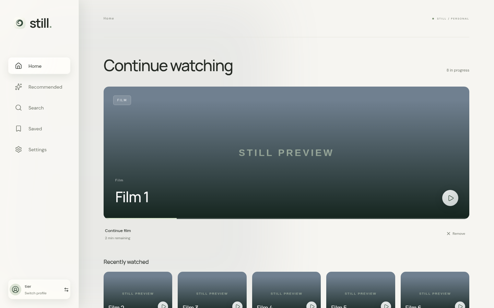

## Read this first

Still is an interface and playback client for the Stremio account and addon ecosystem. It does not give you movies, illegal torrents, subscription access or preconfigured addons.

- Still uses the addons already configured on your Stremio account.
- Still does not run a torrent index, tracker or content catalogue.
- Still does not host media or bypass DRM and subscription checks.
- A torrent source still requires a Stremio streaming engine. The Linux app can start the official Stremio Service locally; other platforms need a reachable engine.
- A BitTorrent engine may download and upload pieces while a torrent is active. Only use sources you are legally entitled to access.
- Addons are third-party services. Their availability, privacy practices and returned content are outside Still's control.

Configure addons through the standard Stremio web or desktop app first. Still reads that existing addon collection after sign-in.

## Install from source

All builds require Node.js 22.16 or newer and Git.

```sh
git clone https://github.com/KVGT86/still.git
cd still
npm ci
npm run check
```

For a quick browser preview:

```sh
npm run dev
```

Open `http://localhost:5173`. Sign in with Stremio using the QR link or email/password. **Preview app** opens an explicitly labelled preview with Blender Foundation's Big Buck Bunny; it never touches a Stremio account.

Browser tests use installed Chrome by default. Set `PLAYWRIGHT_CHANNEL=chromium` and install Playwright Chromium if preferred. Production builds use `npm run build`; `npm run preview` serves that output locally.

## What Still can do

- Home containing a large latest item, five recent items, then earlier viewing history; Recommended, Search, Saved and Settings stay in the sidebar.
- Stremio login and QR linking, existing addon catalogs, metadata, episodes, streams and subtitles.
- Automatic source selection with mandatory known audio language and a device quality ceiling. Unknown metadata is kept for manual selection. Highest resolution within the ceiling is preferred, then reported peers/seeders; this is availability metadata, not telemetry gathered from other Still users.
- Automatic fallback through matching sources, then a complete manual list with failures marked.
- Profile preferences for audio, optional subtitles and autoplay: on, off, or 07:00–22:00 device local time.
- Continue Watching begins at 2%; completion at 95% queues the next released unwatched episode. Manual removal does not mark watched.
- One Saved collection and feedback-driven catalog ranking: More Like This, Not Interested, Already Watched. This is a deterministic genre-affinity recommendation model and requires no paid AI service.
- Light and neutral dark themes, directional remote focus, Magic Remote pointer interaction, and a landscape-only tablet UI.
- Android's built-in Media3 player; browser/webOS HTML video with HLS fallback.

## What Still cannot do

- Install, configure or recommend addons for you.
- Guarantee that a source is legal, safe, online or correctly labelled.
- Play DRM-protected services outside the Stremio addon playback contract.
- Make every codec, HDR format, subtitle format or audio track work on every device.
- Put Tailscale on an LG television. The LG app needs a local-network engine or a tailnet-capable gateway.
- Provide child accounts, parental controls or owner roles. Profile PINs only discourage casual access.
- Operate as a reliable offline library. The app assumes an internet connection.
- Replace a VPN, debrid provider, torrent index or media server.

## Interface gallery

Every screenshot uses labelled fixture data. Light is the default theme; dark is available per device.

| Page          | Light                                                            | Dark                                                           |
| ------------- | ---------------------------------------------------------------- | -------------------------------------------------------------- |
| Home          |                 | 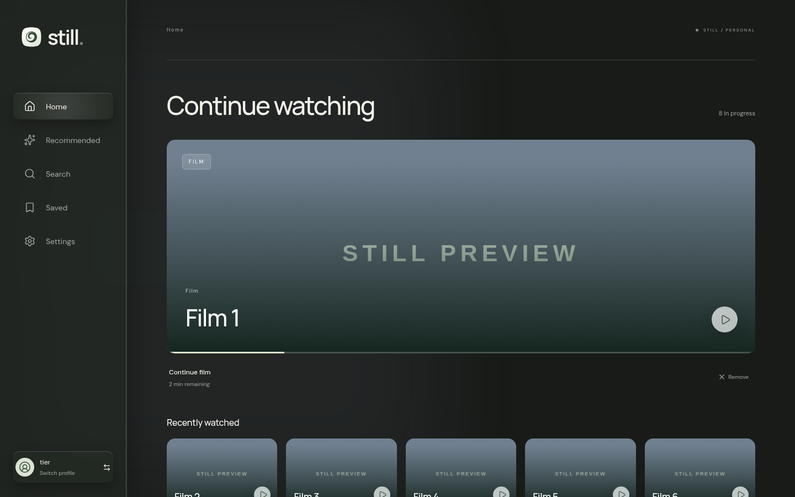                |
| Recommended   | 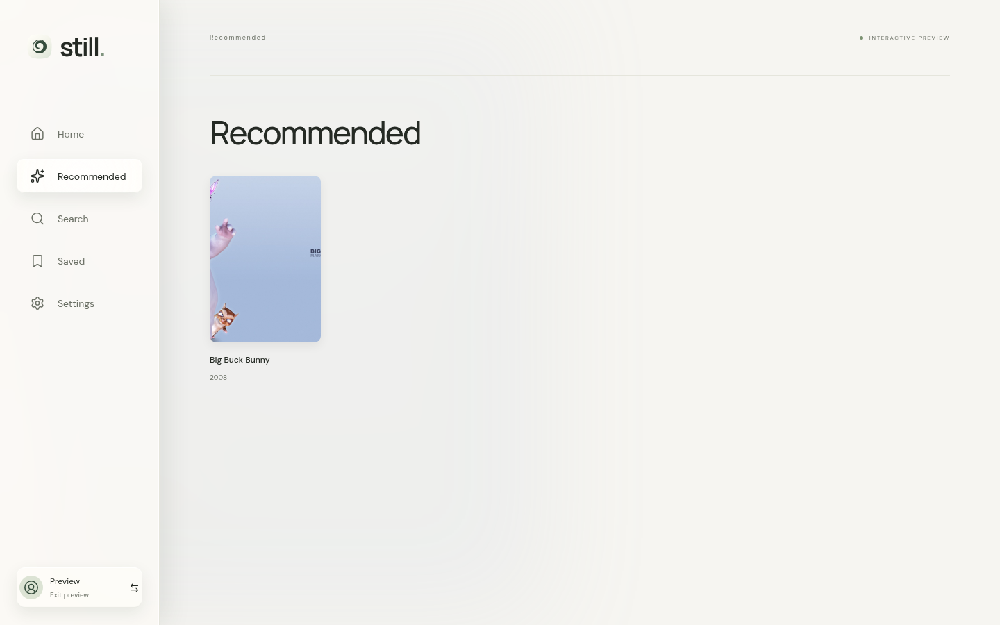  | 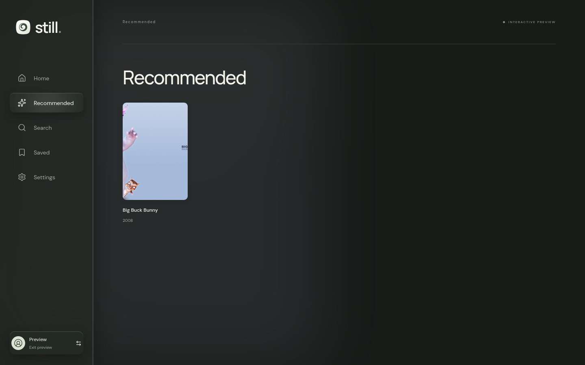  |
| Search        | 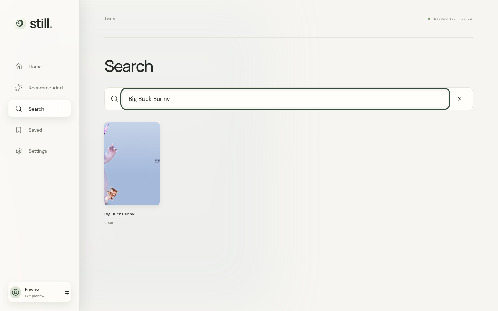            | 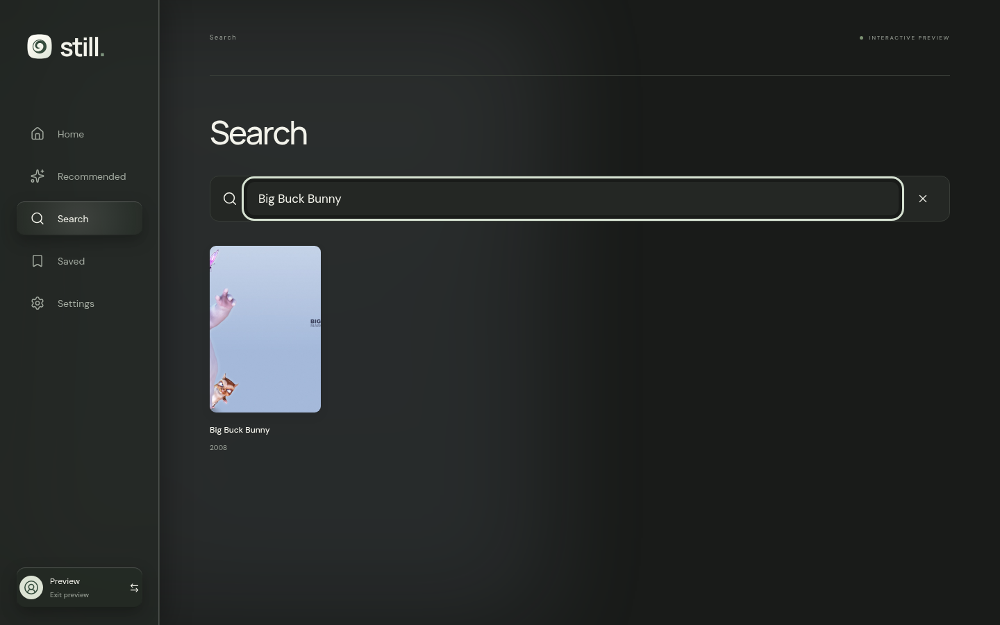            |
| Saved         | 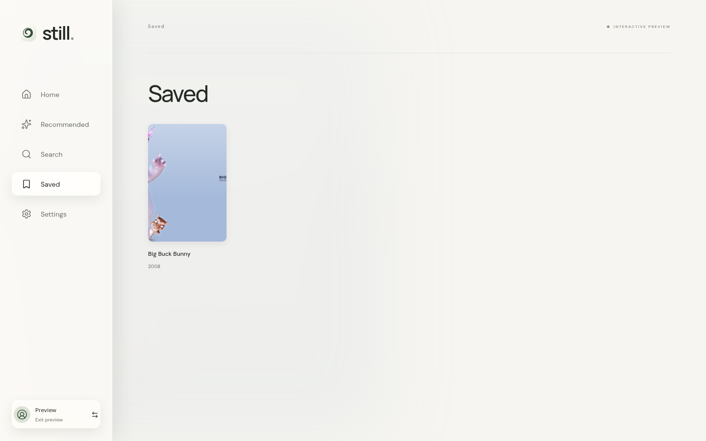              | 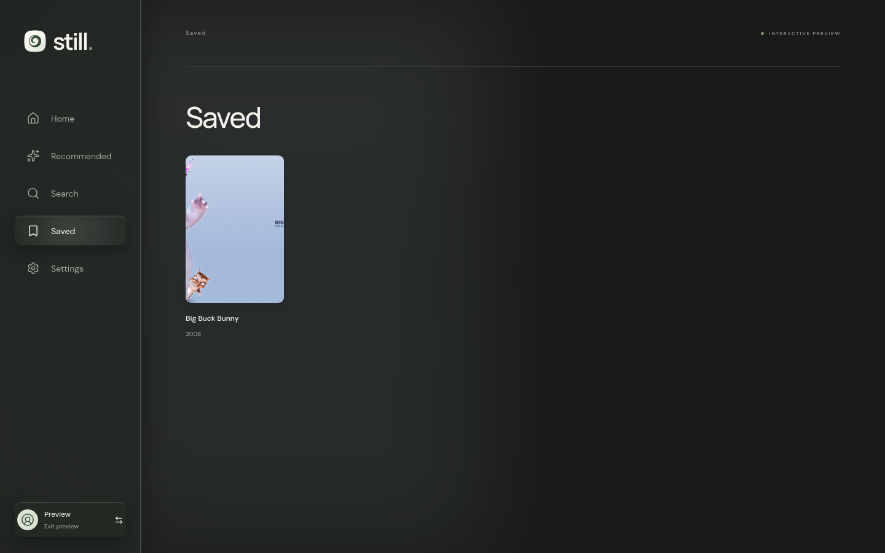              |
| Settings      | 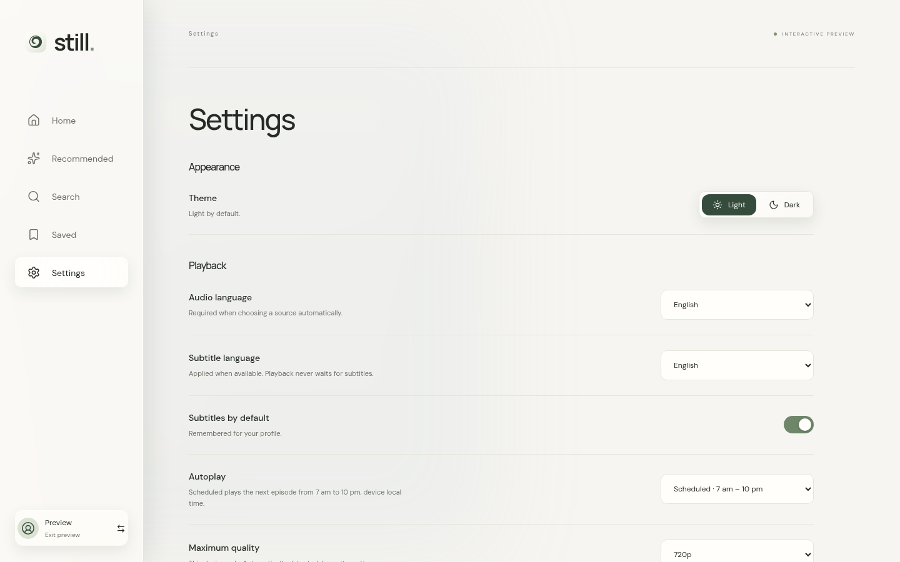        | 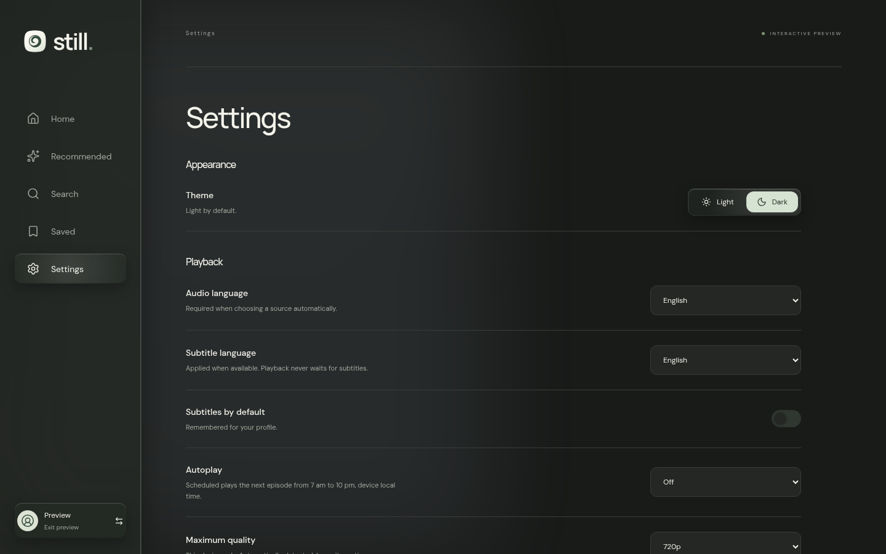        |
| Title details | 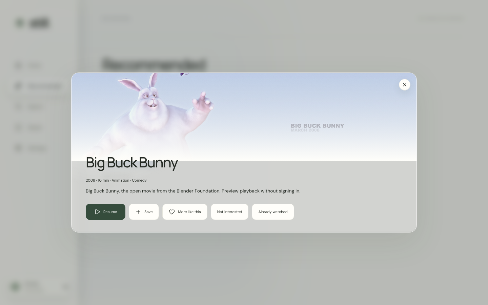    | 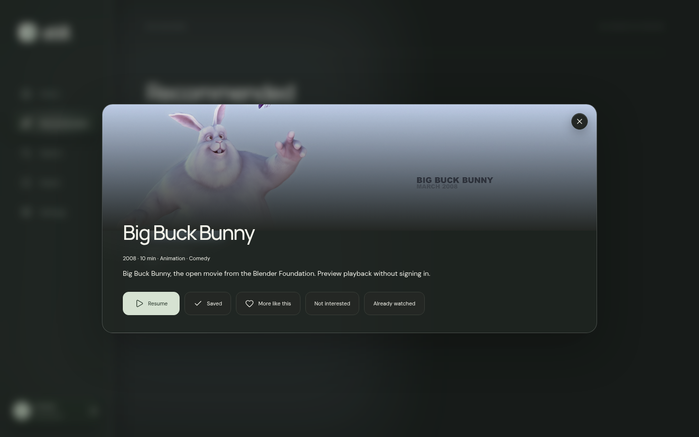    |
| Profiles      | 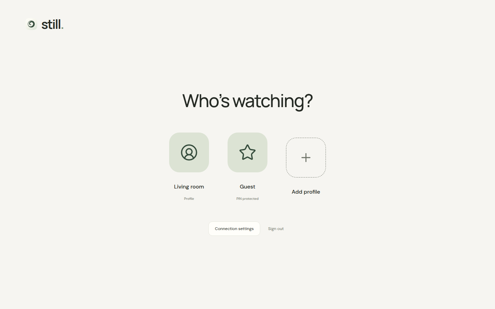 | 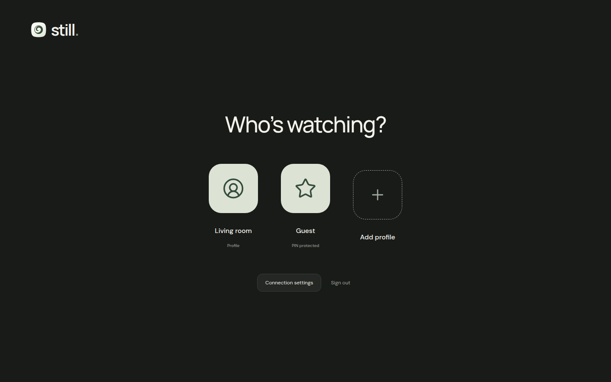 |

## Compatibility

| Platform               | Status                                 | Player                             | Torrent-source requirement                           | Important limits                                                                    |
| ---------------------- | -------------------------------------- | ---------------------------------- | ---------------------------------------------------- | ----------------------------------------------------------------------------------- |
| Linux x86-64           | Supported                              | Electron video with HLS conversion | Built-in managed Stremio Service, or a remote engine | Local engine requires `dpkg-deb`; installed engine files use about 240 MiB          |
| Android TV / Google TV | Supported on Android 8+                | Native Media3                      | Reachable Stremio streaming engine                   | Sideloaded APK; remote-control navigation is supported                              |
| Android tablet         | Supported on Android 8+                | Native Media3                      | Reachable Stremio streaming engine                   | Landscape only; tested layout target is Galaxy Tab S7                               |
| LG webOS               | Targeted at webOS 22+                  | Native browser video and HLS       | LAN engine or tailnet gateway                        | Developer Mode sideloads expire; codecs and Magic Remote behaviour vary by firmware |
| Desktop browser        | Development and self-hosted web client | Browser video and hls.js           | Reachable Stremio streaming engine                   | Browser CORS, mixed-content and codec rules still apply                             |
| Windows                | Host only                              | Reuses an installed Stremio engine | Existing Stremio installation                        | No native Windows Still shell yet; use the hosted web client                        |

HTTP(S) streams can play directly when the device supports their codecs. Android can also handle DASH through Media3. Browser and webOS external subtitles currently require CORS-enabled WebVTT URLs. Android accepts WebVTT and SubRip. ASS conversion is not implemented.

## Choose an account setup

### Path A: one profile, no server

Use this when one person uses the Stremio account.

1. Configure addons in the standard Stremio app.
2. Install Still on each device.
3. Sign in to the same Stremio account on each device.
4. Leave **Settings > Household profiles** disconnected.
5. On Linux, leave **Stremio streaming server** blank to use the local engine. On Android, browser or webOS, enter a reachable Stremio engine URL for torrent sources.

Saved titles and playback state use Stremio's library. Stremio's watched-episode bitfield is preserved when a series is updated. Audio, subtitle, autoplay and recommendation-feedback settings remain local to each device. No companion database is required.

### Path B: synchronized household profiles

Use this when several people share one Stremio account but need separate Saved lists and viewing history.

1. Deploy the optional profile service using Docker or the Windows host guide below.
2. Keep it private through Tailscale or an explicitly trusted home LAN. Do not expose the service or streaming engine directly to the public internet.
3. In Still, open **Settings > Household profiles > Connect service** and enter the service URL. Enter a URL, not a folder or database file.
4. The first profile imports the current Stremio Saved list and progress.
5. Add the remaining profiles. They begin empty and can have optional 4 to 8 digit PINs.
6. Connect every Still device to the same service and choose the relevant profile.

Household Saved titles, progress, preferences and recommendation feedback sync through the service. Household activity does not write back into the Stremio account. Disconnecting the service returns the app to the untouched single-profile Stremio path.

The service has no administrator, owner or child role. Anyone with the account-level service session can list and create profiles. A PIN protects that profile's state through the app, but a server or device administrator can still inspect local data.

## Self-host over Tailscale

For a Windows host on E: with capped storage and an existing Stremio installation, see [Windows hosting](docs/windows-host.md). It includes automatic startup, persistent Saved/progress, seven daily SQLite snapshots and private HTTPS endpoints.

```sh
docker compose up -d --build
tailscale serve --bg http://127.0.0.1:8787
```

Enter the resulting **HTTPS** tailnet URL under Settings → Connect service. The service and production web client share this address. The compose port binds to loopback. No public exposure, extra device pairing, paid account or external recommendation API is needed.

Enter a running service URL, not a folder or file path. The service creates its database automatically in its data directory; Docker manages that directory through the named volume below. It stores profile names, PIN hashes, Saved titles, playback progress, preferences, recommendation feedback and temporary service sessions. It stores no videos, downloaded artwork, Stremio passwords or Stremio authentication keys. The database starts small and grows with your saved titles and viewing history. A single-profile setup can leave Connect service blank and needs no self-hosted database.

Without Docker:

```sh
npm run build
npm run server
```

The service defaults to `127.0.0.1:8787`; override `HOST`, `PORT` or `DATABASE` when needed. SQLite lives at `data/still.sqlite`. Back up the SQLite database using SQLite's backup mechanism, or stop the service and back up the entire data directory including WAL files. Docker stores it in the `still-data` volume.

The service verifies the signed-in Stremio account, stores hashed short-lived service tokens, and namespaces profiles by Stremio user ID. It does not store your Stremio password or authentication key. PINs use salted scrypt hashes, have a retry limit, and are never returned by the API. Brief interruptions queue changes locally; item timestamps merge independent updates. It is not designed for sustained offline use.

An LG TV needs a route to the tailnet address through your network: installing the app does not install Tailscale on webOS. Use a Tailscale-capable gateway/router or another network arrangement that makes the server reachable. Android devices can use their normal Tailscale client.

## Linux desktop

```sh
npm ci
npm run package:linux
```

The x86-64 Linux builds are in `artifacts/linux/`: a portable `.tar.gz`, a Debian `.deb`, and an unpacked executable at `artifacts/linux/linux-unpacked/still`. The desktop app has its own window and persistent profile storage; it does not require the local preview server to run. Sign in again inside the desktop app because its storage is independent of the browser preview.

Install the Debian package on Debian or Ubuntu:

```sh
sudo apt install ./artifacts/linux/Still-0.1.2-linux-amd64.deb
```

Or extract and run the portable package:

```sh
mkdir -p Still
tar -xzf artifacts/linux/Still-0.1.2-linux-x64.tar.gz -C Still
./Still/still
```

The Electron renderer is sandboxed with Node integration disabled and context isolation enabled. External sign-in links open in the normal browser. The desktop application includes only the compiled client and native shell; the optional profile service stays separate.

Torrent playback is built into the x86-64 Linux app. Leave **Settings → Stremio streaming server** blank to use it. On first torrent playback, Still downloads the official Stremio Service 0.1.21 engine archive (about 62 MiB), verifies its pinned SHA-256, and installs the runtime and FFmpeg tools in its own application data directory (about 240 MiB installed). `dpkg-deb` must be available; it is included on Debian/Ubuntu systems. No separate Stremio application or profile service is required.

The engine starts on demand on a private loopback port. Torrents use the addon's trackers and requested file index; an omitted index selects the largest file. Local playback uses the engine's HLS conversion, with H.264 and AAC/MP3 audio support. Unsupported audio such as AC3 is converted; demanding video conversions depend on the laptop's CPU. Persistent torrent caching is disabled. Temporary video/transcode files live in an isolated session directory and are removed when Still closes, along with its owned engine and conversion processes. The installed engine programs remain for future launches.

The engine is downloaded directly from [Stremio's official distribution](https://github.com/Stremio/stremio-service), separately from Still's MIT application source. Upstream components retain their own licensing and copyright notices. Setting a remote streaming-server address overrides the local engine and uses that server's playback path instead.

`npm run install:desktop` adds a per-user Applications-menu launcher and icon-theme assets pointing at the unpacked build. The Linux app ID and desktop entry both use `io.still.client` for correct dock grouping. Quit and reopen an already-running older version after updating its icon or app identity.

All branded icons come from `src/assets/app-icon.svg`. PNG sizes for the window, dock, Linux package, Android and webOS are generated from that same squircle artwork. In-app controls use Lucide.

```sh
npm run desktop
npm run test:desktop
```

Desktop tests need a graphical session or `xvfb-run`. For the actual Stremio connection and playback checks, follow [Testing the Stremio connection](docs/testing-stremio.md).

## Android TV / Google TV / Galaxy Tab S7

The Android project requires JDK 17+ and Android SDK platform/build tools 35. Set `ANDROID_HOME` or create an untracked `android/local.properties` with `sdk.dir=/path/to/sdk`.

```sh
npm ci
npm run package:android
cd android
sh gradlew assembleDebug
adb install -r app/build/outputs/apk/debug/app-debug.apk
```

For wireless TV installation, enable Developer options and Wireless debugging, pair with `adb pair TV_IP:PAIRING_PORT`, connect with `adb connect TV_IP:CONNECTION_PORT`, then install with:

```sh
adb -s TV_IP:CONNECTION_PORT install -r app/build/outputs/apk/debug/app-debug.apk
```

The launcher appears on both TV and tablet. Landscape is enforced. The bundled client is served from Android's secure asset origin. Only bundled UI pages load inside the WebView; local file and content access are disabled, and native playback uses Media3 with preferred audio/text language selection and request headers. The debug APK is for personal sideloading. Sign a release build with a protected key and stable version code before distributing public releases.

## LG webOS

The initial engine target is **webOS 22+** (Chromium 87+); exact codec and firmware behavior needs testing on the real TV. Install LG's Developer Mode app, sign in, enable Developer Mode, and keep its session renewed before using the CLI.

```sh
npm ci
npm run package:webos
tools/webos/node_modules/.bin/ares-setup-device
tools/webos/node_modules/.bin/ares-install -d YOUR_TV artifacts/webos/io.still.client_0.1.2_all.ipk
tools/webos/node_modules/.bin/ares-launch -d YOUR_TV io.still.client
```

Enable LG's Developer Mode app and configure its key first. Sideloads remain subject to LG Developer Mode session expiry/renewal rules. See the [LG CLI guide](https://webostv.developer.lge.com/develop/tools/cli-dev-guide).

webOS uses a classic IIFE JavaScript bundle rather than ES module script tags, because packaged file-origin apps cannot safely rely on module loading. App resources are bundled; catalog artwork and media remain remote. The app supports standard directional keys and pointer events. Magic Remote hardware calibration must be verified on-device.

LG's CLI is isolated in `tools/webos/` and installed automatically by the webOS packaging command. Its upstream dependency tree currently has security advisories; it is used only for local packaging/device operations and is never included in the application or companion-service image. Do not run its optional development servers on an untrusted network.

The LG app cannot run Tailscale itself. Use the Windows host's explicitly enabled LAN URLs when the television and server share a trusted network. Otherwise, provide a Tailscale-capable router or gateway. Never forward the profile-service or streaming-engine ports directly to the public internet.

## Stored data and security

The client keeps its Stremio session, service address, service token, device settings and cached profile state in platform local storage. These values are inside the browser or app sandbox, but they are not protected by an operating-system keychain. Sign out and clear the app's storage before sharing or transferring a device or operating-system account.

The optional service stores the verified Stremio account ID, profile names and avatars, salted scrypt PIN hashes, hashed expiring service tokens, Saved titles, playback progress, preferences and recommendation feedback. It does not persist the Stremio password or raw authentication key, and it does not store videos or downloaded artwork.

Addon operators receive the catalogue, metadata, search and stream requests needed to answer the app. Media hosts and torrent peers receive the normal network traffic required for playback.

Read [SECURITY.md](SECURITY.md) before running a public fork. The intended deployment boundary is a private tailnet or explicitly trusted LAN, not the open internet.

## Playback requirements and limits

- HTTP(S) streams play directly when their codecs are supported by the device.
- Linux desktop handles torrent sources through its managed local engine. Browser, Android and webOS clients still need a reachable Stremio streaming server under Playback settings. Sharing a Windows or tailnet engine is separate from the Linux integration.
- HLS works through native support or hls.js; Android also handles DASH through Media3. DRM-protected services are outside the addon playback contract.
- Browser and webOS audio-track selection depends on the source/engine; automatic source filtering still requires matching audio metadata. Android selects the preferred track natively.
- Browser/webOS external subtitles currently require WebVTT URLs and CORS. Android supports WebVTT and SubRip external tracks. ASS conversion is not implemented.
- An HTTPS-hosted client requires HTTPS media/server endpoints unless the platform permits mixed content. Prefer HTTPS tailnet service URLs.
- Resolution detection reflects the current display mode, not a guarantee about every codec/HDR combination. Lower the per-device ceiling if required.
- LG uses the native device video width rather than the app's graphics resolution; a 1080p app surface can therefore still select 4K video on a UHD television.
- Actual account, addon, codec and remote-control behavior still requires testing on each physical device. Automated tests use reserved fixture accounts, domains and media.

## Security review status

- No personal usernames, home paths, IP addresses, tailnet names, credentials, signing keys or real addon URLs are tracked in the repository.
- The client and service dependency graph currently reports no known npm advisories.
- The Electron renderer uses context isolation, sandboxing, disabled Node integration, denied permission requests and a restricted custom protocol.
- Bundled clients use a Content Security Policy that permits network data and media but only permits scripts from the packaged app.
- The profile API validates state size and shape, namespaces data by verified Stremio account, hashes tokens, rate-limits sign-in and PIN attempts, and does not use cookie authentication.
- The isolated LG packaging CLI currently has upstream dependency advisories. It is not included in Still packages or the profile-service image. Do not expose its optional development servers to an untrusted network.

This review does not certify third-party addons, the upstream Stremio engine, torrent peers, media URLs, operating systems or device firmware.

## Repository layout

| Path                | Purpose                                                                        |
| ------------------- | ------------------------------------------------------------------------------ |
| `src/`              | Shared React interface, Stremio API integration, profile sync and web playback |
| `shared/domain.mjs` | Source ranking, thresholds, autoplay, recommendations and merge rules          |
| `server/`           | Optional Express + SQLite profile service                                      |
| `android/`          | Android WebView shell and native Media3 player                                 |
| `scripts/`          | webOS IPK packaging and Android asset sync                                     |
| `tests/`            | Domain and API isolation checks                                                |
| `e2e/`              | Browser interaction checks                                                     |
| `docs/`             | Product specification and verification notes                                   |

The application code is licensed MIT. The Stremio watched-bitfield package is MIT; dependencies retain their own licenses. Stremio and the Blender films retain their respective names and artwork rights. No Stremio client code was copied or forked.
